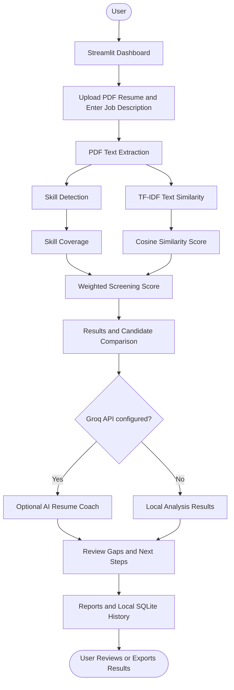

# 🤖 CareerPilot AI — Resume Intelligence & Career Skill-Gap Navigator

<p align="center">
  
</p>

<p align="center">
  <b>An AI-assisted career dashboard that compares resumes with job descriptions, explains detected skill matches and gaps, and helps users plan their next steps.</b>
</p>

<p align="center">
  
  
  
  
  
</p>

<p align="center">
  <a href="https://github.com/ashfaque-ahmed78">Developer Profile</a> •
  <a href="https://github.com/ashfaque-ahmed78/CareerPilot-AI">GitHub Repository</a>
</p>

---

## 📌 Overview

**CareerPilot AI** is a Streamlit-based resume intelligence dashboard designed to help users compare one or more PDF resumes against a target job description. It combines PDF text extraction, built-in skill detection, TF-IDF text similarity, an explainable screening score, and optional Groq-powered AI coaching.

Instead of showing only a single number, CareerPilot AI helps users inspect recognised skill matches, detected gaps, and possible next steps. It also provides batch comparisons, interview practice, a learning roadmap, downloadable reports, and local screening history where supported by the current application.

> **Responsible-use note:** CareerPilot AI is a hackathon prototype and decision-support tool. Its scores are not hiring probabilities, proof of a candidate's abilities, or a substitute for human review.

---

## 🎯 Project Goals

- Make resume-to-job-description comparison easier to understand.
- Show the components behind a screening score.
- Identify recognised skill matches and potential skill gaps.
- Compare multiple resumes against one target role.
- Offer optional AI-assisted resume feedback and preparation ideas.
- Help users turn detected gaps into practical learning steps.
- Keep screening history locally for convenient review.
- Provide a foundation for future career-path and skill-development features.

---

## ✨ Key Features

### 📊 Interactive Dashboard

- View headline screening metrics and recent reports, where available.
- Review screening scores and skill-coverage information.
- Use charts, tables, and dashboard components provided by the current app.
- Navigate between screening and career-preparation tools.

### 📄 Resume Screening

- Upload text-based PDF resumes.
- Compare resume content with a supplied job description.
- Calculate a screening score from detected skill coverage and text similarity.
- Review the analysis rather than relying on an unexplained score.

### 👥 Batch Candidate Comparison

- Screen multiple PDF resumes against one target role.
- Compare candidates in a ranked results table.
- Export comparison results to CSV when the relevant control is available.

### 🧩 Skill-Gap Analysis

- Detect skills recognised in the job description.
- Identify recognised skills also found in the resume.
- Highlight job-description skills that were not detected in the resume.
- Use the detected gaps as prompts for further review and learning.

*A skill not detected by the program is not proof that the candidate lacks it. The vocabulary and extracted PDF text can be incomplete.*

### 🧠 Optional AI Resume Coach

When a valid Groq API key is configured, the app can request AI-generated feedback such as:

- resume strengths;
- possible areas for improvement;
- relevant keywords to consider;
- project ideas for skill development;
- a suggested professional summary.

AI-generated advice can be inaccurate or incomplete. Verify every suggestion against the original resume and job description.

### 🎤 Interview Preparation

- Generate role- and skill-related practice questions.
- Draft answers in the interface where supported.
- Use the questions as practice prompts, not as guaranteed interview questions.

### 🗺️ Learning Roadmap

- Turn detected skill gaps into suggested learning steps.
- Organise preparation around areas that may need attention.
- Treat the roadmap as guidance, not a verified or guaranteed career path.

### 🗃️ Past Reports and Local History

- Store screening history in a local SQLite database.
- Revisit and search saved reports where supported.
- Export structured report/history data as JSON where available.
- Use the app's deletion controls, if enabled, to remove saved history.

### 📥 Report Exports

| Format | Intended use |
|---|---|
| CSV | Candidate comparison and spreadsheet analysis |
| JSON | Structured screening reports or history export |
| TXT | Plain-text interview practice or roadmap content |

Available fields and download controls depend on the current application implementation.

---

## 🏗️ System Architecture



### 🔍 How It Works

1. **User input:** provide a job description and upload one or more PDF resumes.
2. **Text extraction:** the PDF parser extracts selectable text from each resume.
3. **Skill detection:** the analyzer searches for skills included in its built-in vocabulary.
4. **Text similarity:** TF-IDF vectors and cosine similarity estimate textual overlap between the resume and job description.
5. **Score calculation:** skill coverage and text similarity are combined using the documented weighting.
6. **Results display:** the dashboard presents scores, detected skills, gaps, and batch comparisons where relevant.
7. **Optional AI assessment:** if configured, Groq can provide additional coaching.
8. **History and export:** reports can be stored locally and exported through available controls.

The precise sequence and available controls depend on the version of the application being run.

---

## 🧮 Screening Score Methodology

CareerPilot AI uses this explainable heuristic:

**Screening Score = (70% × Skill Coverage) + (30% × Text Similarity)**

| Component | Weight | Explanation |
|---|---:|---|
| Detected skill coverage | 70% | The percentage of recognised job-description skills also detected in the resume |
| TF-IDF text similarity | 30% | Textual overlap estimated using TF-IDF vectors and cosine similarity |
| Final screening score | 100% | Weighted combination of the two components |

### How to interpret the score

- Skill coverage depends on the built-in skill vocabulary and the quality of extracted text.
- Text similarity measures wording overlap, not complete semantic understanding or real-world ability.
- Synonyms, context, formatting, and relevant experience may be missed.
- A low score does not automatically mean a candidate is unsuitable.
- The result is **not** a probability of getting hired or a prediction of job performance.

Use the score to organise review, then check the original resume and apply consistent, job-related criteria.

---

## ⚙️ AI and Automation Pipeline

| Stage | Technology / method | Result |
|---|---|---|
| PDF parsing | PDF text extraction | Resume text for analysis |
| Skill recognition | Built-in vocabulary matching | Recognised resume and job skills |
| Skill-gap calculation | Comparison of recognised skills | Matches and potential gaps |
| Text similarity | TF-IDF and cosine similarity | Similarity score |
| Score aggregation | Weighted formula | Explainable screening score |
| Optional AI coaching | Groq API | Additional feedback and suggestions |
| Local persistence | SQLite | Saved screening history |
| Downloads | CSV / JSON / TXT features | Portable reports where supported |

### What is automated?

- extracting selectable text from PDF files;
- identifying recognised skill keywords;
- calculating skill coverage and text similarity;
- combining score components;
- comparing multiple resumes against one role;
- requesting optional AI feedback;
- saving or exporting supported reports.

### What is not automatically verified?

- whether a candidate truly has a skill;
- the accuracy of qualifications or work history;
- whether a job advertisement is authentic or current;
- the quality or accreditation of a suggested course;
- whether a person should be hired.

**Animation note:** the banner at the top uses an externally hosted animated image. The Streamlit app may use interactive charts and widgets; custom in-app animations should only be claimed if they are implemented in the source code.

---

## 🖥️ Dashboard Sections

| Section / Tool | Purpose |
|---|---|
| Dashboard | Review available screening metrics, recent scores, and latest reports |
| Resume screening | Analyse one resume against a job description |
| Batch screening | Compare multiple resumes against the same role |
| Skill-gap analysis | Inspect detected matches and missing recognised keywords |
| Resume Coach | Review AI-assisted strengths and improvement ideas |
| Interview Prep | Practise role-specific questions |
| Learning Roadmap | Review suggested next learning steps |
| Past Reports | Revisit locally saved screening history |
| Export controls | Download supported reports |

The exact navigation labels and visual layout depend on the `app.py` version in the repository.

---

## 🛠️ Technology Stack

| Technology | Purpose |
|---|---|
| Python | Main programming language |
| Streamlit | Dashboard and user interface |
| PDF parsing dependency | Extracts text from PDF resumes |
| scikit-learn, if included in the current code | TF-IDF vectorisation and cosine similarity |
| SQLite | Local screening-history database |
| Groq API | Optional AI-powered assessment and coaching |
| Git & GitHub | Version control and repository hosting |

The authoritative dependency list is `requirements.txt`. The app's exact imports determine which libraries are required.

---

## 📂 Project Structure

```text
CareerPilot-AI/
│
├── app.py                    # Streamlit dashboard and application flow
├── analyzer.py               # Skill detection, comparison, and scoring logic
├── resume_parser.py          # PDF text extraction helpers
├── requirements.txt          # Python package dependencies
├── .env.example              # Environment-variable template
├── .gitignore                # Excludes secrets and local runtime files
├── README.md                 # Project documentation
│
├── .env                      # Local API key configuration (do not commit)
├── .venv/                    # Local Python virtual environment (do not commit)
└── careerpilot_history.db    # Local SQLite history (runtime data; do not commit)
```

The `.env`, `.venv/`, and `careerpilot_history.db` entries are local/runtime files and should be ignored by Git. The database may be created when the application runs.

### Main files explained

- **`app.py`** — builds the Streamlit interface, handles user interactions, and presents results and available tools.
- **`analyzer.py`** — contains resume/job analysis helpers, recognised skill matching, and scoring logic.
- **`resume_parser.py`** — extracts text from supported PDF resumes.
- **`requirements.txt`** — lists the Python dependencies installed for the project.
- **`.env.example`** — documents environment-variable names without exposing real credentials.
- **`.gitignore`** — prevents secrets, virtual environments, cache files, and local database files from being committed.
- **`careerpilot_history.db`** — stores local screening history when the application uses its SQLite persistence.

---

## 🚀 Getting Started

### 1. Prerequisites

- Windows, Linux, or macOS;
- Python version compatible with the packages in `requirements.txt`;
- Git, if cloning from GitHub;
- internet access for package installation;
- an optional Groq API key for AI coaching.

### 2. Clone the Repository

```bash
git clone https://github.com/ashfaque-ahmed78/CareerPilot-AI.git
cd CareerPilot-AI
```

If you already have the project folder, open a terminal in the folder containing `app.py` and `requirements.txt`.

### 3. Create a Virtual Environment

**Windows PowerShell:**

```powershell
python -m venv .venv
.\.venv\Scripts\Activate.ps1
```

**Linux / macOS:**

```bash
python3 -m venv .venv
source .venv/bin/activate
```

### 4. Install Dependencies

```bash
python -m pip install --upgrade pip
python -m pip install -r requirements.txt
```

On Windows, if activation is blocked or you want to use the virtual environment directly:

```powershell
.\.venv\Scripts\python.exe -m pip install -r requirements.txt
```

### 5. Configure Environment Variables

If the project uses `.env` for local configuration, create it from the example:

```powershell
Copy-Item .env.example .env
notepad .env
```

If `.env` already exists, edit it instead of overwriting it.

Example configuration:

```env
GROQ_API_KEY=your_actual_groq_key
GROQ_MODEL=openai/gpt-oss-120b
```

Use the model name supported by your account and the application's current implementation. Add only variables actually required by your code.

**Security:** never commit `.env`, API keys, private resumes, or screening-history databases to GitHub.

### 6. Run CareerPilot AI

```powershell
python -m streamlit run app.py
```

Or run Streamlit using the virtual environment directly:

```powershell
.\.venv\Scripts\python.exe -m streamlit run app.py
```

Open the local URL printed in the terminal, commonly:

```text
http://localhost:8501
```

To stop the server, return to the terminal and press **Ctrl + C**.

---

## 🧭 How to Use the Application

1. Launch CareerPilot AI.
2. Open the relevant screening tool in the dashboard.
3. Paste the target job description.
4. Upload one text-based PDF resume or several resumes for batch comparison.
5. Run the analysis using the available interface control.
6. Review the screening score and its components.
7. Inspect detected matches and potential skill gaps.
8. If configured, review the optional AI Coach suggestions.
9. Use interview practice and roadmap recommendations as preparation aids.
10. Export or revisit the report using the available controls.

### Tips for better results

- Prefer PDFs with selectable text rather than scanned images.
- Provide a complete and role-specific job description.
- Check detected skills against the source resume.
- Review the original resume instead of judging by score alone.
- Edit AI-generated text before using it in a real application.

---

## 📁 Reports and Local Data

### SQLite screening history

Screening history is stored locally in `careerpilot_history.db`. This is useful for a single-user prototype, but it is not a secure multi-user database.

### Export formats

| Format | Common purpose |
|---|---|
| CSV | Review candidate comparison data in spreadsheet software |
| JSON | Keep structured report or history data |
| TXT | Save plain-text interview or roadmap content |

The exact fields and available exports depend on the current implementation.

### Data cleanup

- Keep a backup only if you need to preserve local history.
- Do not publish reports containing personal information.
- Use the app's history controls, if present, to delete saved records.
- Deleting local history does not delete copies already exported elsewhere.

---

## 🔐 Security, Privacy & Responsible Use

- Store `GROQ_API_KEY` in a local environment file or deployment secret manager.
- Keep `.env`, private resumes, and `careerpilot_history.db` out of GitHub.
- When AI coaching is enabled, relevant text may be sent to Groq. Only submit candidate data when you have permission and understand the service's applicable data-handling terms.
- Obtain permission before processing another person's resume.
- Do not use the screening score as the sole basis for rejecting, ranking, or hiring candidates.
- Skill matching may miss synonyms, context, and non-traditional experience.
- Minimise the amount of personal data processed and delete local reports when no longer needed.
- Before deploying to multiple users, add appropriate authentication, access controls, and secure data handling.

---

## 🧪 Testing & Debugging

Test the application in separate layers:

1. **PDF parsing:** verify that a text-based PDF produces readable text.
2. **Skill detection:** check recognised skills against the source resume and job description.
3. **Score calculation:** verify the displayed score and component percentages.
4. **Batch screening:** test more than one resume and review the comparison table.
5. **AI integration:** check the optional Groq configuration and handle API errors.
6. **History and exports:** confirm that reports save and downloads contain the expected data.

### Common issues

**`No module named streamlit`**

```powershell
python -m pip install -r requirements.txt
python -m streamlit run app.py
```

If using a virtual environment:

```powershell
.\.venv\Scripts\python.exe -m pip install -r requirements.txt
.\.venv\Scripts\python.exe -m streamlit run app.py
```

**Groq AI does not respond**

- Confirm that `GROQ_API_KEY` is set correctly.
- Verify the application loads `.env` if you rely on that file.
- Confirm the API key and model are valid for your account.
- Restart the app after changing configuration.
- Check the terminal for API errors. Local analysis may still work if the current implementation supports fallback mode.

**The resume produces no text**

The PDF may be scanned or image-only. OCR is not included in this prototype.

**Git shows `.env` or the database as staged**

```powershell
git status
git check-ignore -v .env careerpilot_history.db
```

If an API key has already been pushed publicly, revoke or rotate it immediately. Deleting it in a later commit alone does not remove it from Git history.

---

## ⚠️ Current Limitations

- Scanned/image-only PDFs need OCR, which is not included.
- The skill vocabulary is a starter list and may miss synonyms or specialised terminology.
- TF-IDF measures text overlap rather than full semantic meaning.
- AI feedback may be inaccurate or incomplete.
- Recommendations are not guaranteed to be current, accredited, or suitable for every user.
- Local SQLite history is intended for a local prototype, not secure multi-user production.
- Custom in-app animations, verified live job-market data, authentication, and synchronised progress should not be assumed unless implemented in the current source code.

---

## 🔮 Future Improvements

Potential future development directions include:

- expand skill coverage and synonym handling;
- add OCR for scanned resumes;
- show evidence snippets for detected skills;
- compare profiles with 3–5 career roles or job descriptions;
- connect learning suggestions to verified resources;
- add milestones and progress tracking;
- improve accessibility and mobile responsiveness;
- add automated tests for parsing, scoring, and exports;
- introduce authentication and secure multi-user storage for a production version;
- add and test UI animations where useful.

These are proposed improvements, not claims that every feature is already implemented.

---

## 🧠 Engineering Principles

CareerPilot AI demonstrates several practical software-engineering concepts:

- modular separation of interface, analysis, and PDF parsing;
- explainable scoring rather than a single opaque AI judgement;
- optional AI integration alongside local analysis;
- environment-based secret configuration;
- structured data storage and downloadable reports;
- iterative testing and responsible handling of candidate information.

---

## 👨‍💻 About the Developer

<p align="center">
  <b>Niaz Gul</b><br/>
Software Engineering Student | Cybersecurity Enthusiast
</p>

<p align="center">
  <a href="https://github.com/ashfaque-ahmed78">
    
  </a>
  <a href="https://github.com/ashfaque-ahmed78/CareerPilot-AI">
    
  </a>
</p>

---

<p align="center">
  <b>Navigate your career with clearer insights, practical feedback, and informed next steps.</b>
</p>

<p align="center">
  
</p>
